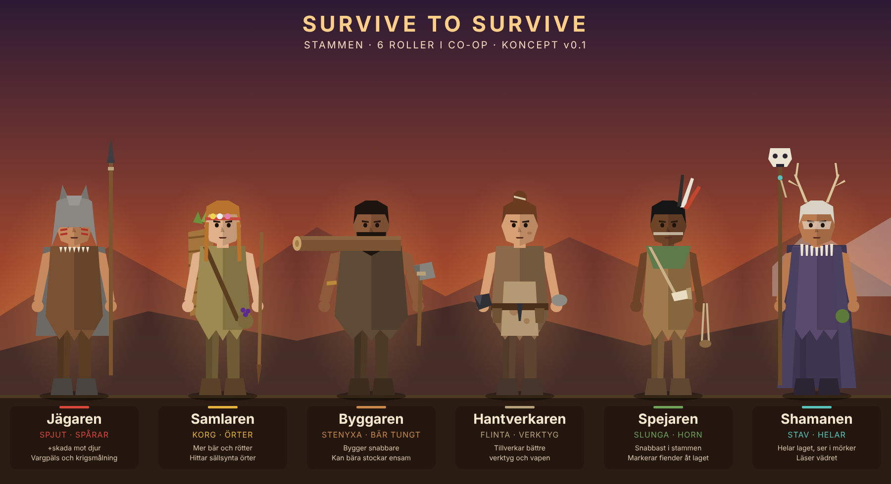

# Survive to Survive

Överlevnadsspel på stenåldern för **1–6 spelare i co-op**: Age of Empires + Minecraft + Far Cry.



## Innehåll

| Mapp | Vad |
|------|-----|
| [`docs/designdokument.md`](docs/designdokument.md) | Designdokument: kärnloop, tidsåldrar, roller, resurser, färdplan |
| [`prototype/`](prototype/) | Spelbar prototyp 0.1 i webbläsaren (three.js) |
| [`art/`](art/) | Konceptbilder. `karaktarer.svg` genereras av `make_characters.py` |

## Spela prototypen

Öppna `prototype/index.html` i Chrome eller Edge (dubbelklicka på filen). Inget behöver installeras.

**Kontroller:** WASD gå · mus titta · klick/E samla · C stenyxa · F lägereld · E vid elden: lägg på trä · Q ät bär · Shift spring · Space hoppa

**Mål:** Överlev nätterna. Utan eld sjunker värmen på natten, och utan mat sjunker hungern.

## Ändra karaktärsbilden

```bash
python art/make_characters.py
```
Färger och utrustning för varje roll finns i funktionerna i skriptet.
