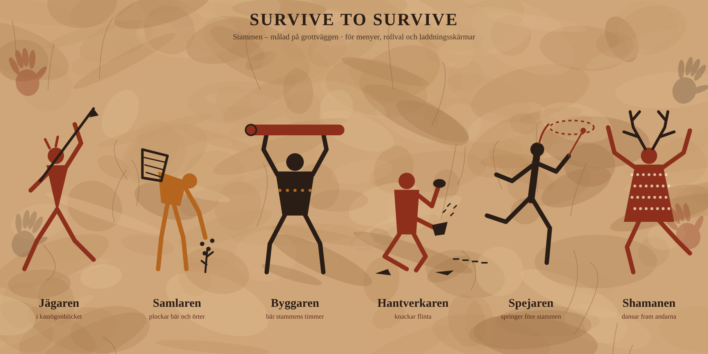

# Survive to Survive

Överlevnadsspel på stenåldern för **1–6 spelare i co-op**: Age of Empires + Minecraft + Far Cry, i stilen **levande grottmålning**.



## Innehåll

| Mapp | Vad |
|------|-----|
| [`docs/designdokument.md`](docs/designdokument.md) | Designdokument: kärnloop, tidsåldrar, roller, resurser, färdplan |
| [`prototype/`](prototype/) | Spelbar prototyp 0.5 i webbläsaren (three.js): eldhjärtat, tidsålder 1 → 2, rollval, specialbyggnader, karta, djur, byggande |
| [`prototype/djur.html`](prototype/djur.html) | Förhandsvisning av djuren (varg, björn, vildsvin) – modellerna finns i `animals.js` |
| [`art/`](art/) | Konceptbilder. `grottmalning_roller.svg` (spelets stil) genereras av `make_grottmalning.py` |

## Spela prototypen

Öppna `prototype/index.html` i Chrome eller Edge (dubbelklicka på filen). Inget behöver installeras.

**Kontroller:** WASD gå · mus titta · mushjul/1–5 byt verktyg · klick använd/bygg · håll högerklick kasta spjut/skjut pil · P pilar · E samla/slakta/mata elden · C yxa · V spjut · T fackla · R byt byggnad · M karta · B pilbåge · K skinnkläder · F stek kött · Q ät · Shift spring · Space hoppa

**Mål:** Överlev nätterna. Utan eld sjunker värmen på natten, och utan mat sjunker hungern.

## Ändra karaktärsbilden

```bash
python art/make_grottmalning.py
```
Färger och utrustning för varje roll finns i funktionerna i skriptet.
